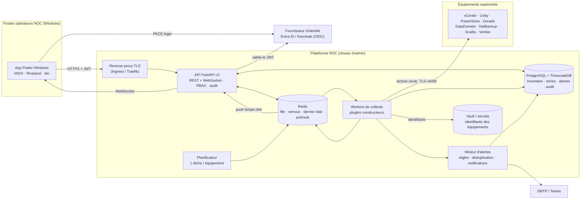
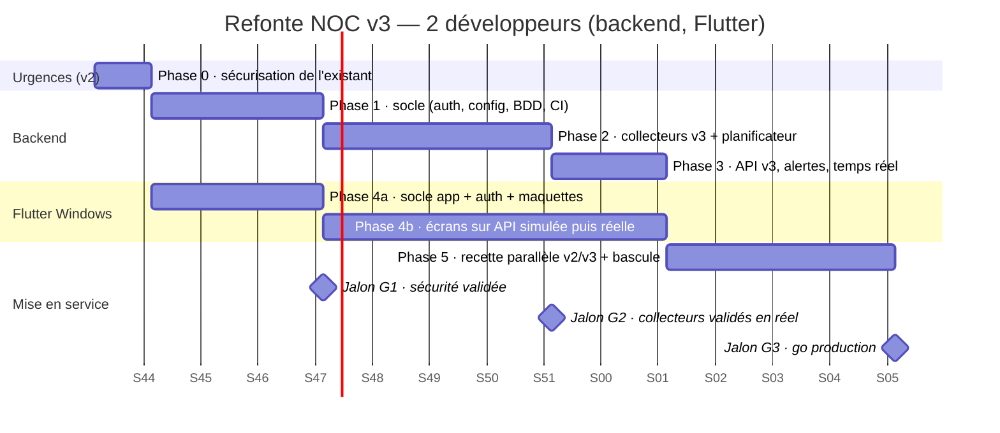

# Refonte NOC Dashboard — audit et plan Flutter Windows

*26/10/2026 — audit de la v2 et proposition de refonte*

On ne peut pas remettre la v2 en production telle qu'elle est :

- l'API n'a **aucune authentification** ;
- des **mots de passe d'équipements réels** sont écrits en clair dans le code ;
- les **latences** sont tirées au hasard, et ce sont elles qui déclenchent les alertes e-mail.

La refonte proposée :

- garde **Python** pour la collecte, car pyVmomi et les SDK constructeurs y sont matures ;
- remplace le frontend web par une **application Flutter Windows** ;
- ajoute une **authentification d'entreprise** (OIDC) avec des rôles ;
- regroupe le stockage dans **PostgreSQL + TimescaleDB**.

Estimation : **14 semaines pour 2 développeurs**, dont une semaine d'urgences sécurité sur l'existant.

Périmètre relu : tout le backend (36 fichiers Python), `docker-compose*.yml`, `k8s-production.yaml`, les Dockerfiles, `nginx.conf` et le frontend compilé. Les sources du frontend (`frontend/src`) sont absentes du dossier : je n'ai pu analyser que le build `dist/`.

---

## 1. Sécurité

Les failles sont classées de la plus grave à la moins grave. Les numéros S1… sont repris dans le plan.

| # | Gravité | Problème | Où | Conséquence |
|---|---|---|---|---|
| S1 | Critique | Identifiants de production en clair (comptes de service vCenter et Dorado, compte personnel) | `backend/update_creds.py` | Toute personne qui a le dossier a l'accès admin à l'infrastructure. **Rotation immédiate.** |
| S2 | Critique | Aucune authentification ni autorisation sur l'API REST et le WebSocket. `INTERNAL_API_KEY` est déclarée mais jamais lue | toutes les routes de `app/api` | N'importe qui sur le réseau peut ajouter, modifier ou archiver des équipements, changer les réglages et exporter l'inventaire |
| S3 | Critique | Les réglages SMTP et le destinataire des alertes sont modifiables sans authentification | `PUT /api/inventory/settings/{key}`, `core/smtp.py` | Les alertes peuvent être détournées ou coupées, et le serveur SMTP peut être pointé vers un hôte contrôlé par un attaquant |
| S4 | Critique | Injection Flux : des paramètres de requête sont insérés sans échappement dans les requêtes InfluxDB | `vm_diagnostic.py` (`vcenter`, `cluster`, `vm_name`), `app_endpoints.py` (noms de VM) | Lecture de tout le bucket et requêtes coûteuses lancées par n'importe qui |
| S5 | Critique | Une valeur par défaut connue est utilisée pour dériver la clé de chiffrement des mots de passe, et cette même `SECRET_KEY` sert aussi pour les JWT | `models/inventory.py:12` | Si la variable manque, tous les mots de passe en base peuvent être déchiffrés |
| S6 | Haute | Secrets écrits en clair dans le manifeste Kubernetes, et Ingress sans TLS | `k8s-production.yaml` | Les secrets fuient via le dépôt, et les identifiants circulent en HTTP sur le réseau |
| S7 | Haute | Mots de passe par défaut écrits dans le code (`noc_secure_password`, `noc_super_secret_token_12345`, `CHANGE_ME`) | `core/database.py`, `core/influx.py`, `docker-compose.yml` | Un oubli de configuration démarre l'application avec des secrets publics |
| S8 | Haute | Un simple `GET /api/metrics/realtime` déclenche une vraie connexion à **chaque** équipement dès que le cache Redis a expiré | `metrics.py` (`get_collector_fallback`) | Un client anonyme peut multiplier les connexions vers vCenter et les baies, avec un risque de verrouillage des comptes de service |
| S9 | Haute | `POST /inventory/discover` scanne n'importe quelle adresse (ports 22, 443, 8088) | `inventory_endpoints.py` | Scan réseau interne (SSRF) depuis le serveur |
| S10 | Moyenne | TLS jamais vérifié (`verify=False`, `CERT_NONE`) et clés SSH acceptées sans contrôle (`AutoAddPolicy`) | les 8 collecteurs | Une interception permet de récupérer les identifiants des équipements |
| S11 | Moyenne | Exports CSV et Excel sans neutralisation des formules | `reports.py` | Un nom d'équipement commençant par `=` s'exécute à l'ouverture dans Excel |
| S12 | Moyenne | Aucun journal d'audit (qui a ajouté, modifié ou supprimé un équipement) et aucune limite de débit | toute l'API | Impossible de tracer un incident |
| S13 | Basse | Adresse e-mail personnelle écrite en dur comme destinataire par défaut des alertes | `core/smtp.py`, `inventory_endpoints.py` | Fuite d'alertes si la personne change de poste |
| S14 | Basse | Le dossier `.git` est corrompu (`git` ne le reconnaît plus), il n'y a donc ni historique ni moyen de savoir ce qui a été commité, y compris des secrets | racine | Il faut repartir d'un dépôt propre et scanner l'ancien historique s'il existe ailleurs |

---

## 2. Conception

| # | Problème | Pourquoi c'est un problème | Correction dans la v3 |
|---|---|---|---|
| C1 | Le mode démo est mêlé aux vraies données : latences aléatoires, inventaire de VMs statique, détection d'équipement par la fin de l'IP (`.135` → Scality), sparklines inventées, OS et IP par défaut (`10.0.0.10`) | Un NOC ne doit jamais afficher une valeur inventée comme si elle était mesurée | Les simulateurs deviennent des **fixtures de test**, absentes du code de production. Une donnée manquante s'affiche comme « inconnue » |
| C2 | Les alertes de latence partent d'une valeur aléatoire (`random.uniform` + un pic dans 5 % des cas) | De fausses alertes partent par e-mail à chaque cycle | Vraies métriques via `PerformanceManager` (`datastore.totalReadLatency.average`), et moteur d'alerte avec états et seuils |
| C3 | Trois stockages qui se recouvrent : InfluxDB (séries temporelles), `metrics_history` dans PostgreSQL (une ligne par équipement et par minute, à vie) et Redis (dernier état) | Données en double, `metrics_history` grossit sans limite, rapports de plus en plus lents | **TimescaleDB** : un seul SQL, rétention et agrégats continus (horaire, quotidien) |
| C4 | Le processus API exécute lui-même les collecteurs (repli dans `/realtime`) | Couplage fort, risque de saturer l'API, double connexion aux équipements | Seuls les workers parlent aux équipements. L'API ne lit que la base et le cache |
| C5 | Polling planifié deux fois : `beat_schedule` **et** `add_periodic_task` | Chaque équipement est interrogé deux fois par minute | Planificateur unique, une tâche par équipement, intervalle propre à chaque équipement |
| C6 | Un cycle unique, sans verrou, pour tous les équipements (pool de 16 threads, délai d'attente de 300 s) | Un équipement lent bloque le cycle, et deux cycles peuvent tourner en même temps | Une tâche par équipement, verrou Redis, délais d'attente de 10 à 20 s, disjoncteur |
| C7 | Le registre des collecteurs est copié dans `scheduler.py` et `metrics.py` | Deux listes à tenir à jour | Registre unique de plugins |
| C8 | Le format de sortie des collecteurs n'est pas typé (`dict` libre, champs différents d'un constructeur à l'autre) | Le frontend et les rapports devinent les champs (`capacity_total` ou `capacity_total_tb`) | Modèles Pydantic normalisés : `DeviceHealth`, `CapacitySample`, `PerfSample`, `Alert` |
| C9 | Le changement de `polling_interval` n'est jamais pris en compte (il n'est lu qu'au démarrage de Beat) | Le réglage affiché dans l'interface ne fait rien | Planificateur dynamique qui relit la configuration |
| C10 | La capacité CPU et RAM est stockée en « TB », et un « temps avant saturation » est calculé pour le CPU | L'analyse capacitaire est fausse pour ces ressources | Modèle séparé capacité / performance, avec projection uniquement sur des données cumulatives |
| C11 | La table `anomalies_saturation` n'est jamais remplie, et le WebSocket n'est pas utilisé par le frontend | Code mort, fonctionnalités annoncées mais vides | Les supprimer, ou les implémenter réellement |
| C12 | Schéma créé au démarrage par `create_all`, sans migrations | Toute évolution du schéma casse les bases existantes | Migrations Alembic |
| C13 | Configuration dispersée en `os.getenv` dans chaque module, avec des valeurs par défaut différentes | Comportement imprévisible d'un environnement à l'autre | Un seul `Settings` (pydantic-settings) qui refuse de démarrer s'il manque un secret |
| C14 | Aucun test, aucune CI, aucune mesure d'observabilité sur les collecteurs | Les régressions et les pannes de collecte passent inaperçues | Tests sur des réponses constructeurs enregistrées, CI, métriques Prometheus par collecteur |

---

## 3. Implémentation

| # | Défaut | Où |
|---|---|---|
| I1 | Des routes `async def` font des appels bloquants (SQLAlchemy synchrone, client InfluxDB, `requests`, `socket`), ce qui fige la boucle d'événements de chaque worker | `metrics.py`, `reports.py`, `vm_diagnostic.py`, `/discover` |
| I2 | Le cache Redis expire au bout de 60 s, comme l'intervalle de polling : dès qu'un cycle a du retard, l'équipement apparaît vide puis déclenche une collecte depuis l'API (S8) | `scheduler.py:437` |
| I3 | Une vingtaine de `except: pass` ou `except Exception: pass` masquent les erreurs de collecte | collecteurs DataDomain, PowerStore, vCenter, Dorado… |
| I4 | `get_password()` renvoie `""` en cas d'échec de déchiffrement, et le collecteur tente alors une connexion sans mot de passe | `models/inventory.py:59` |
| I5 | Un nouvel équipement est marqué `ONLINE` avant toute collecte | `inventory_endpoints.py:191, 224` |
| I6 | Les rapports chargent **tout** l'historique de chaque ressource en mémoire, avec une requête par ressource (N+1) | `reports.py:_generate_all_reports_data` |
| I7 | Division par zéro possible si `total_tb = 0` (Pandas renvoie alors `inf` ou `NaN`) | `analytics_service.py:33` |
| I8 | Le split lecture/écriture des latences de datastore est généré au hasard au moment de l'écriture | `core/influx.py:140` |
| I9 | L'e-mail d'alerte est envoyé de façon synchrone dans la boucle de collecte, et la configuration SMTP est relue en base à chaque envoi | `scheduler.py:356` |
| I10 | Celery stocke chaque résultat complet (plusieurs Mo pour un vCenter) dans Redis | `celery_app.py` (`backend=`) |
| I11 | La tâche d'écoute du WebSocket est globale à chaque worker, n'est jamais relancée si elle plante et `connect()` n'est pas protégé | `ws.py` |
| I12 | Le frontend compilé contient `{}.VITE_API_URL \|\| "http://localhost:8000"` : l'injection `__VITE_API_URL__` ne fonctionne pas pour ces modules, qui appellent toujours localhost en production | `frontend/dist`, `inject-env.sh` |
| I13 | Images Kubernetes en `:latest`, PostgreSQL déployé en `Deployment` au lieu de `StatefulSet`, aucune NetworkPolicy | `k8s-production.yaml` |
| I14 | Image Python 3.10 sur Debian Bullseye avec `build-essential` dans l'image finale, pas de build en plusieurs étapes, dépendances non figées (`>=`) | `backend/Dockerfile`, `requirements.txt` |
| I15 | Déconnexion Unity incorrecte (`DELETE …/loginSessionInfo/instances/0` au lieu de `POST /api/types/loginSessionInfo/action/logout`). Les sessions restent ouvertes côté baie | `unity_collector.py:199` |
| I16 | `vcenter` stocké dans chaque VM = la valeur de configuration `host` (IP ou FQDN), le nom de cluster vient du parent de l'hôte (faux pour un hôte autonome) et les disques sont détectés par le nom de type | `vcenter_collector.py` |
| I17 | Fichiers parasites : scripts ponctuels à la racine, `celery.log`, `.antigravitycli`, fonction `datetime_seed_offset` inutilisée | racine, `app_endpoints.py` |

À vérifier contre la documentation des constructeurs : l'endpoint Dorado `performancestatistictask/0` et les unités de `currBandwidth` et `currLatency` pour Unity.

---

## 4. Architecture cible



Comment le schéma se lit :

- **Seuls les workers parlent aux équipements.** Ils récupèrent les identifiants dans Vault au moment de la collecte et écrivent des mesures typées dans TimescaleDB.
- **Le dernier état passe par Redis**, qui le pousse à l'application via le WebSocket de l'API.
- **L'API ne fait jamais d'appel réseau vers l'infrastructure.**

Principes :

1. **Données vraies uniquement.** Une valeur absente est affichée comme absente. Les simulateurs ne vivent que dans les tests.
2. **Séparation lecture et collecte.** L'API est sans état et peut tourner en plusieurs exemplaires. Les workers aussi, avec un verrou par équipement.
3. **Contrat d'API unique.** Le schéma OpenAPI généré par FastAPI sert à générer le client Dart. Aucune URL n'est écrite à la main dans l'application.
4. **Moindre privilège.** Comptes en lecture seule sur les équipements, rôles `viewer`, `operator` et `admin` dans l'API, aucun mot de passe d'équipement ne revient vers le client.

Découpage du backend :

```
backend/
  noc/
    core/          settings, logging, sécurité (JWT/OIDC), db async, redis
    domain/        modèles Pydantic : Device, CapacitySample, PerfSample, Alert, AuditEvent
    api/v3/        routes (devices, telemetry, capacity, vms, alerts, settings, ws)
    collectors/    base.py (interface) + 1 paquet par constructeur + registry.py
    scheduler/     planification par équipement, verrous, disjoncteurs
    alerting/      règles, évaluation, déduplication, notifications
    reports/       capacité, exports (CSV/XLSX neutralisés)
  migrations/      Alembic (+ hypertables Timescale)
  tests/           unitaires, contrat API, collecteurs sur réponses enregistrées
```

---

## 5. Choix techniques

| Domaine | Choix | Raison |
|---|---|---|
| Client | Flutter 3.x, cible **Windows desktop** | Demande du projet. Une seule base de code, avec la possibilité d'ajouter une version web ou macOS plus tard |
| API | FastAPI + SQLAlchemy 2 **async** (asyncpg) + Pydantic v2 | Réutilise les compétences Python existantes et corrige I1 |
| Collecte | Python 3.12, pyVmomi, httpx, asyncssh. Workers Celery **ou** arq (asyncio) | Écosystème SDK constructeurs. arq est plus simple si toute la collecte devient asynchrone |
| Planification | Une tâche par équipement, Redis comme verrou (`SET NX PX`), intervalle par équipement | Corrige C5, C6 et C9 |
| Séries temporelles | **PostgreSQL 16 + TimescaleDB** (hypertables, agrégats continus, rétention) | Supprime InfluxDB et Flux (S4, C3), SQL paramétré partout. Alternative : garder InfluxDB 2 avec des requêtes paramétrées (`params=`) |
| Cache / temps réel | Redis 7 (dernier état sans expiration courte, pub/sub) | Corrige I2 |
| Authentification | OIDC (Entra ID si l'entreprise l'utilise, sinon Keycloak) avec PKCE côté client, validation du JWT côté API | Corrige S2. Authentification unique pour les opérateurs |
| Autorisation | RBAC : `viewer` (lecture), `operator` (acquittement d'alertes, exports), `admin` (équipements, réglages) | Corrige S2 et S3 |
| Secrets | HashiCorp Vault (KV v2 ou Transit) ; à défaut, chiffrement d'enveloppe AES-GCM avec une clé maître dédiée et rotation (`MultiFernet`) | Corrige S1, S5 et S6 |
| Contrat | OpenAPI → `openapi-generator` (dart-dio) | Supprime les URL écrites à la main (I12) |
| Observabilité | Logs JSON, `/metrics` Prometheus (durée et échecs par collecteur), `/health` et `/ready` qui vérifient vraiment la base | Corrige C14 et I3 |
| Déploiement | Helm, ExternalSecrets, Ingress TLS, StatefulSet pour PostgreSQL (ou une base managée), NetworkPolicy, images en version figée et signées | Corrige S6 et I13 |
| Qualité | pytest, tests sur réponses enregistrées par constructeur, ruff, mypy, bandit, pip-audit ; côté Flutter : flutter_test, golden tests, very_good_analysis | Corrige C14 |

---

## 6. Application Flutter Windows

**Pile** : Flutter stable, `fluent_ui` (aspect Windows 11 natif) ou Material 3, `flutter_riverpod` (état), `go_router` (navigation), `dio` + client généré (API), `web_socket_channel` (temps réel), `fl_chart` ou `syncfusion_flutter_charts` (graphiques), `freezed` et `json_serializable` (modèles), `flutter_secure_storage` (jetons stockés dans le Gestionnaire d'identification Windows), `oauth2` avec redirection locale pour PKCE, `window_manager` (multi-écran pour les murs NOC).

**Structure** (par fonctionnalité) :

```
app/lib/
  core/        config, auth (PKCE, refresh), client API généré, ws, thème, erreurs
  features/
    overview/      grille d'état global, sparklines, compteurs d'alertes
    devices/       inventaire, ajout/édition (admin), statut de collecte
    vcenter/       clusters, hôtes, VMs, datastores, saturation, filesystems
    storage/       baies : capacité, IOPS, latence, débit
    backup/        DataDomain, NetBackup : jobs, taux de succès, dédup
    capacity/      tendances, temps avant saturation, exports
    applications/  regroupement de VMs par application métier
    alerts/        liste, acquittement, historique, règles (admin)
    settings/      SMTP, seuils, intervalles (admin)
  shared/      widgets, graphiques, tableaux paginés
```

**Écrans repris de la v2** : vue d'ensemble, inventaire, diagnostic des VMs (saturation, latence, filesystems), explorateur de métriques, applications, rapports capacitaires, réglages.

**Ajouts** : centre d'alertes avec acquittement, mode « mur NOC » plein écran avec rotation automatique, état « données périmées » visible quand un équipement n'a plus de données depuis plus de deux intervalles.

**Sécurité côté client** :

- aucun secret dans le binaire ;
- jetons dans le Gestionnaire d'identification Windows ;
- TLS obligatoire, avec épinglage de l'autorité de certification interne si possible ;
- mot de passe d'un équipement saisi uniquement à l'ajout ou au remplacement, jamais relu.

**Distribution** : paquet MSIX signé avec le certificat de code de l'entreprise, déployé par Intune ou SCCM. URL de l'API configurable par la politique de déploiement ou un fichier `appsettings.json` en lecture seule. Mise à jour par MSIX App Installer.

---

## 7. Plan d'implémentation



### Phase 0 — Sécuriser l'existant (semaine 1, avant toute nouvelle fonctionnalité)

- [ ] Changer **tous** les mots de passe présents dans `update_creds.py`, puis supprimer le fichier.
- [ ] Changer les secrets du manifeste k8s et de `.env`, et les déplacer dans un gestionnaire de secrets.
- [ ] Désactiver l'envoi d'e-mails d'alerte de latence, qui sont fondés sur des valeurs aléatoires (C2).
- [ ] Limiter l'accès réseau à l'API v2 au VLAN NOC (pare-feu ou NetworkPolicy) en attendant l'authentification.
- [ ] Recréer un dépôt git propre et scanner les anciennes copies avec `gitleaks`.
- [ ] Remplacer les comptes de service des équipements par des comptes **en lecture seule**.

### Phase 1 — Socle backend (semaines 2 à 4)

- Nouveau dépôt (monorepo `backend/`, `app/`, `deploy/`), `Settings` unique, logs JSON, CI (ruff, mypy, pytest, bandit, pip-audit, gitleaks).
- PostgreSQL 16 + TimescaleDB, Alembic, schéma v3 : `devices`, `device_credentials_ref`, `capacity_samples`, `perf_samples`, `vm_samples`, `alerts`, `alert_rules`, `audit_events`, `applications`.
- Authentification OIDC et RBAC, journal d'audit, limitation de débit, CORS restreint.
- Gestion des secrets (Vault ou chiffrement d'enveloppe) et procédure de rotation.
- **Jalon G1** : test d'intrusion interne sur l'API, sans aucune vulnérabilité critique ou haute.

### Phase 2 — Collecteurs v3 (semaines 5 à 8)

- Interface `Collector` typée, registre unique, délais d'attente de 10 à 20 s, disjoncteur, TLS vérifié avec une autorité de certification par équipement, `known_hosts` pour SSH.
- Planificateur : une tâche par équipement, verrou, intervalle propre à chaque équipement, relance progressive en cas d'échec.
- Portage dans l'ordre de criticité : vCenter (vraies latences via `PerformanceManager`), Dorado, Unity, PowerStore, DataDomain, NetBackup, Scality, Veritas.
- Pour chaque constructeur : réponses réelles enregistrées puis anonymisées pour les tests, et validation des unités avec la documentation.
- **Jalon G2** : 7 jours de collecte réelle en parallèle de la v2, écarts de capacité inférieurs à 1 % et zéro valeur inventée.

### Phase 3 — API v3, alertes, temps réel (semaines 9 et 10)

- Routes v3 paginées, filtrées et validées. Agrégats Timescale pour les graphiques sur 1 h, 24 h, 7 j et 30 j.
- Moteur d'alertes : règles en base, états `open` / `ack` / `resolved`, déduplication, notifications asynchrones (SMTP, Teams).
- WebSocket authentifié : un premier état complet à la connexion, puis les changements.
- Exports CSV et XLSX avec neutralisation des formules (S11), générés en tâche de fond pour les gros volumes.

### Phase 4 — Application Flutter Windows (semaines 2 à 10, en parallèle)

- 4a (semaines 2 à 4) : projet, thème, navigation, authentification PKCE, client généré depuis un OpenAPI provisoire, serveur simulé (Prism), maquettes validées par les opérateurs.
- 4b (semaines 5 à 10) : écrans dans l'ordre vue d'ensemble → inventaire → vCenter → stockage → sauvegarde → capacité → alertes → réglages, puis branchement sur l'API réelle à la fin de la phase 3. Golden tests et tests d'intégration.
- Pipeline MSIX signé.

### Phase 5 — Recette et bascule (semaines 11 à 14)

- Fonctionnement en parallèle v2 / v3, recette par les opérateurs NOC, test de charge (100 équipements, 5 000 VMs).
- Reprise de l'inventaire et des applications de la v2 avec ré-saisie ou import des identifiants dans Vault. L'historique InfluxDB n'est repris que s'il est nécessaire (il contient des latences inventées).
- Runbooks, alertes de supervision de la plateforme elle-même, sauvegarde et restauration PostgreSQL testées.
- **Jalon G3** : passage en production et arrêt de la v2.

---

## 8. Questions ouvertes

- [ ] Fournisseur d'identité disponible : Entra ID, AD FS ou Keycloak à installer ?
- [ ] Vault existe-t-il déjà dans l'entreprise, ou faut-il partir sur le chiffrement d'enveloppe ?
- [ ] Hébergement cible : Kubernetes (cluster existant ?) ou une VM avec Docker Compose ?
- [ ] Nombre d'équipements et de VMs visé, et rétention souhaitée (brut 30 j, horaire 1 an ?)
- [ ] Faut-il garder une version web en plus de l'application Windows ?
- [ ] Où sont les sources du frontend v2 (`frontend/src`) ? Utiles pour reprendre les maquettes.
- [ ] Taille réelle de l'équipe et date de mise en production visée, pour ajuster les 14 semaines.
